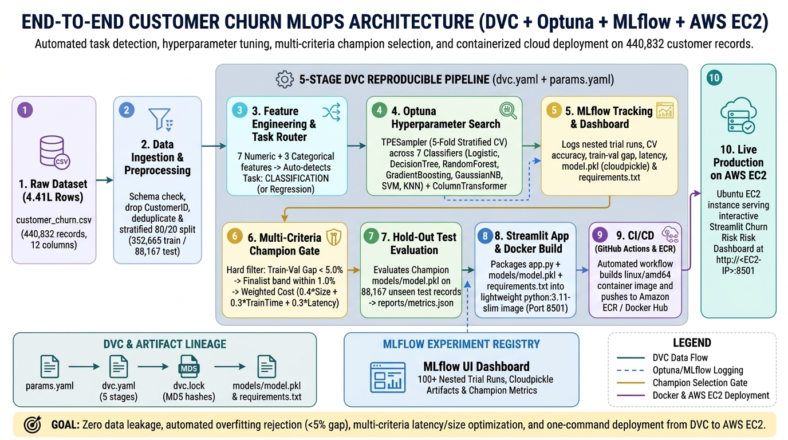

# End-to-End Customer Churn MLOps Pipeline (`DVC` + `Optuna` + `MLflow` + `Docker` + `AWS EC2`)

An end-to-end, reproducible **Machine Learning Operations (MLOps)** system engineered on **440,832 customer records** (`~4.41 Lakhs`). The pipeline automatically detects the task type (**Classification vs. Regression**), performs leakage-free preprocessing via `ColumnTransformer`, runs **Optuna (`TPESampler`) Bayesian hyperparameter optimization** with **5-Fold Stratified Cross-Validation** across **7 classification algorithms**, logs all nested trials and `cloudpickle` model artifacts (`model.pkl` + `requirements.txt`) to the **MLflow Dashboard**, selects the production champion via a **Multi-Criteria Cost Gate** (Accuracy Gap + Model Size + Training Time + Prediction Latency), and packages an interactive **Streamlit** application into a lightweight **Docker** image for **AWS EC2** deployment.

---

## System Architecture



---

## Key MLOps Highlights

1. **Large-Scale Customer Churn Dataset (`440,832` Records):**
   - **Training Split (80% Stratified):** `352,665` customer records
   - **Hold-Out Test Split (20% Stratified):** `88,167` unseen customer records
   - **Features (10 Predictive + 1 Target):**
     - **7 Numeric Features:** `Age`, `Tenure`, `Usage Frequency`, `Support Calls`, `Payment Delay`, `Total Spend`, `Last Interaction`
     - **3 Categorical Features:** `Gender` (`Female`/`Male`), `Subscription Type` (`Basic`/`Standard`/`Premium`), `Contract Length` (`Monthly`/`Quarterly`/`Annual`)
     - **Target (`Churn`):** Binary classification label (`1` = Churned, `0` = Retained)

2. **Automatic Problem-Type Router (`Classification` vs. `Regression`):**
   - Inspects target column distribution in `src/model_building.py` (`detect_problem_type()`):
     - Discrete binary/multiclass targets (`Churn` $\in \{0, 1\}$) automatically route to **Classification** (`StratifiedKFold`, 7 classification estimators, `Accuracy`/`F1`/`Precision`/`Recall`/`ROC-AUC`).
     - Continuous numerical targets automatically route to **Regression** (`KFold`, 6 regression estimators, `RMSE`/`MAE`/`R²`).

3. **Zero-Leakage 5-Stage DVC Pipeline (`dvc.yaml` + `dvc.lock` + `params.yaml`):**
   - Exact row deduplication occurs *before* the stratified train/test split (`src/data_preprocessing.py`).
   - Feature scaling (`StandardScaler` / `MinMaxScaler`) and categorical encoding (`OneHotEncoder`) are deferred inside `sklearn.pipeline.Pipeline` (`ColumnTransformer`) so every cross-validation fold fits transformers strictly on fold-training data.
   - Held-out test data (`X_test.csv`, `y_test.csv` — `88,167` records) is never touched until Stage 5 (`src/model_evaluation.py`).

4. **Bayesian Hyperparameter Tuning & MLflow Experiment Tracking:**
   - Tunes **7 classification algorithms** (`LogisticRegression`, `DecisionTree`, `RandomForest`, `GradientBoosting`, `GaussianNB`, `SVM`, `KNN`) using **Optuna `TPESampler`** (`15` trials $\times$ `5`-fold Stratified CV = `525` total model fits).
   - Penalizes overfitted hyperparameter trials during search when `(train_acc - val_acc) >= 5.0%`.
   - Logs all parent models and nested trial runs to **MLflow**, exporting the champion `model.pkl` (`cloudpickle` format) and locked `requirements.txt`.

5. **Multi-Criteria Champion Selection Gate:**
   - **Step 1 (Eligibility Filter):** Rejects any model with `|train_acc - val_acc| >= 5.0%` (`max_accuracy_gap_pct: 5.0`).
   - **Step 2 (Finalist Band):** Retains eligible models within `1.0%` (`accuracy_tolerance_pct: 1.0`) of the highest cross-validation accuracy.
   - **Step 3 (Weighted Operational Cost):** Computes min-max normalized cost across finalists:
     $$\text{Selection Cost} = 0.4 \times \widehat{\text{Size}}_{\text{MB}} + 0.3 \times \widehat{\text{TrainTime}}_{\text{s}} + 0.3 \times \widehat{\text{Latency}}_{\text{ms}}$$

---

## Multi-Criteria Model Benchmark & Champion Selection Results

### 1. Cross-Validation & Operational Efficiency Comparison (`src/model_building.py`)

| Model | CV Val Acc (%) | Train Acc (%) | Gap (pp) | Size (MB) | Fit Time (s) | Latency (ms/row) | Eligible (`<5%` Gap) | Finalist (`<=1%` Band) | Selection Cost |
| :--- | :---: | :---: | :---: | :---: | :---: | :---: | :---: | :---: | :---: |
| `GradientBoosting` | `99.96%` | `100.00%` | `+0.04` | `0.5301` | `5.0100` | `6.4169` | Yes | Yes | `0.3756` |
| **`DecisionTree` (Champion)** | **`99.87%`** | **`99.98%`** | **`+0.10`** | **`0.0160`** | **`1.3730`** | **`2.2621`** | **Yes** | **Yes** | **`0.0000`** |
| `RandomForest` | `99.04%` | `99.70%` | `+0.66` | `6.8499` | `5.5857` | `16.6694` | Yes | Yes | `1.0000` |
| `KNN` | `92.94%` | `96.38%` | `+3.44` | `6.3736` | `0.0384` | `17.0681` | Yes | No | N/A |
| `SVM` | `89.91%` | `89.88%` | `-0.03` | `0.0041` | `0.8954` | `2.2870` | Yes | No | N/A |
| `LogisticRegression` | `89.86%` | `89.84%` | `-0.02` | `0.0042` | `0.5923` | `2.2898` | Yes | No | N/A |
| `GaussianNB` | `82.64%` | `82.35%` | `-0.28` | `0.0042` | `0.4993` | `2.4755` | Yes | No | N/A |

> **Why `DecisionTree` Won Champion Selection:**
> `GradientBoosting` (`99.96%`), `DecisionTree` (`99.87%`), and `RandomForest` (`99.04%`) all passed the `< 5.0%` overfitting filter and entered the `1.0%` finalist band. Among finalists, **`DecisionTree`** is **33x smaller** (`0.0160 MB` vs `0.5301 MB`), **3.6x faster to train** (`1.37s` vs `5.01s`), and **2.8x faster at single-row inference** (`2.26 ms` vs `6.42 ms`), achieving the optimal `0.0000` operational cost.

---

### 2. Hold-Out Test Set Performance (`88,167` Unseen Customers — `src/model_evaluation.py`)

| Model | Test Accuracy | Macro Precision | Macro Recall | Macro F1-Score | ROC-AUC |
| :--- | :---: | :---: | :---: | :---: | :---: |
| **`DecisionTree` (Deployed Champion)** | **`99.98%` (`0.999784`)** | **`99.98%` (`0.999764`)** | **`99.98%` (`0.999798`)** | **`99.98%` (`0.999781`)** | **`0.999906`** |
| `GradientBoosting` | `99.99%` (`0.999898`) | `99.99%` (`0.999882`) | `99.99%` (`0.999910`) | `99.99%` (`0.999896`) | `1.000000` |
| `RandomForest` | `99.69%` (`0.996881`) | `99.64%` (`0.996431`) | `99.72%` (`0.997241`) | `99.68%` (`0.996826`) | `0.999996` |
| `KNN` | `93.35%` (`0.933500`) | `93.17%` (`0.931749`) | `94.10%` (`0.941036`) | `93.30%` (`0.932980`) | `0.967480` |
| `SVM` | `89.40%` (`0.893951`) | `89.11%` (`0.891089`) | `89.58%` (`0.895760`) | `89.27%` (`0.892729`) | `0.959002` |
| `LogisticRegression` | `89.35%` (`0.893532`) | `89.07%` (`0.890650`) | `89.49%` (`0.894891`) | `89.22%` (`0.892228`) | `0.959033` |
| `GaussianNB` | `82.14%` (`0.821362`) | `85.39%` (`0.853942`) | `84.25%` (`0.842500`) | `82.10%` (`0.821008`) | `0.982712` |

---

## Repository Structure

```text
customer-churn-mlops/
├── .dvc/                              # DVC configuration & tracking metadata
├── .github/workflows/
│   └── deploy.yml                     # CI/CD: Build Docker -> Push AWS ECR -> Deploy AWS EC2
├── assets/
│   └── architecture.jpg               # End-to-End MLOps Architecture Diagram
├── data/
│   ├── raw/customer_churn.csv         # 440,833 raw customer records
│   ├── ingested/churn.csv             # Schema-validated & cleaned dataset (440,832 rows)
│   └── processed/                     # Deduplicated & stratified 80/20 splits (X_train, X_test, y_train, y_test)
├── models/
│   ├── model.pkl                      # Winning Champion Pipeline (16 KB DecisionTree + ColumnTransformer)
│   └── *.pkl                          # All 7 tuned candidate pipelines
├── reports/
│   ├── metrics.json                   # DVC-tracked hold-out test & champion selection metrics
│   ├── evaluation_details.json        # Per-class precision/recall/F1 & full 7-model test benchmark
│   ├── model_selection.json           # Multi-criteria champion gate breakdown & best Optuna params
│   ├── model_comparison.csv           # Tabular candidate comparison
│   └── model_comparison.md            # Markdown report of candidate comparison
├── src/
│   ├── __init__.py
│   ├── data_ingestion.py              # Stage 1: Schema validation, drop CustomerID, clean nulls
│   ├── data_preprocessing.py          # Stage 2: Exact deduplication & stratified 80/20 train/test split
│   ├── feature_engineering.py         # Stage 3: Feature/target separation (7 numeric + 3 categorical)
│   ├── model_building.py              # Stage 4: Task detection, Optuna 5-fold CV, MLflow logging & Champion Gate
│   └── model_evaluation.py            # Stage 5: Unbiased evaluation on 88,167 hold-out test records
├── app.py                             # Streamlit interactive Customer Churn Prediction dashboard
├── dvc.yaml                           # 5-stage DVC pipeline definition
├── dvc.lock                           # Locked MD5 hashes for data, code, and model artifacts
├── params.yaml                        # Hyperparameter search, CV, and multi-criteria selection weights
├── requirements.txt                   # MLflow-exported runtime dependencies + Streamlit
├── Dockerfile                         # Production container image (python:3.11-slim, port 8501)
├── .dockerignore                      # Excludes 100+ MB data/mlruns; packages only app.py + models/model.pkl
└── README.md
```

---

## Reproducing the Pipeline Locally

### 1. Create Environment & Install Dependencies
```bash
uv venv .venv --python 3.11
source .venv/bin/activate
uv pip install dvc mlflow optuna scikit-learn pandas numpy scipy pyyaml cloudpickle joblib streamlit
```

### 2. Run the 5-Stage DVC Pipeline
```bash
dvc repro
dvc metrics show
```

### 3. Launch the MLflow Dashboard
```bash
mlflow ui --port 5000
# Open http://localhost:5000 to inspect all 7 models, 105 nested Optuna trial runs, and artifacts
```

### 4. Run the Streamlit App Locally
```bash
streamlit run app.py
# Open http://localhost:8501
```

---

## Docker Build & AWS EC2 Cloud Deployment

Because `.dockerignore` excludes raw datasets, intermediate CSVs, and `mlruns/`, the production Docker image packages only `app.py`, `requirements.txt`, and `models/model.pkl` (`16 KB`).

### Option A: Build on Mac (`linux/amd64`) $\rightarrow$ Push to Docker Hub $\rightarrow$ Run on AWS EC2

#### 1. On Your Mac:
```bash
docker login
docker build --platform linux/amd64 -t <dockerhub-username>/customer-churn-mlops:latest .
docker push <dockerhub-username>/customer-churn-mlops:latest
```

#### 2. On Your AWS EC2 Instance (Ubuntu 22.04/24.04 LTS with Port `8501` open in Security Group):
```bash
sudo apt-get update -y && sudo apt-get install -y docker.io
sudo systemctl start docker && sudo systemctl enable docker
sudo usermod -aG docker ubuntu && newgrp docker

docker pull <dockerhub-username>/customer-churn-mlops:latest
docker run -d --name customer-churn-app --restart always -p 8501:8501 <dockerhub-username>/customer-churn-mlops:latest
```
Access your live deployed application at: **`http://<EC2-PUBLIC-IPv4>:8501`**

### Option B: Automated CI/CD with GitHub Actions & AWS ECR (`.github/workflows/deploy.yml`)
Configure the following repository secrets in GitHub (`Settings -> Secrets and variables -> Actions`):
- `AWS_ACCESS_KEY_ID` & `AWS_SECRET_ACCESS_KEY`
- `AWS_REGION` (e.g., `ap-south-1` or `us-east-1`)
- `AWS_ACCOUNT_ID`
- `ECR_REPOSITORY` (e.g., `customer-churn-mlops`)
- `EC2_HOST` (Your EC2 Public IPv4/DNS)
- `EC2_USER` (`ubuntu`)
- `EC2_SSH_KEY` (Contents of your `.pem` private key)

Every push to `main` automatically builds the production Docker image, pushes it to Amazon ECR, and deploys the updated container to your AWS EC2 server.
